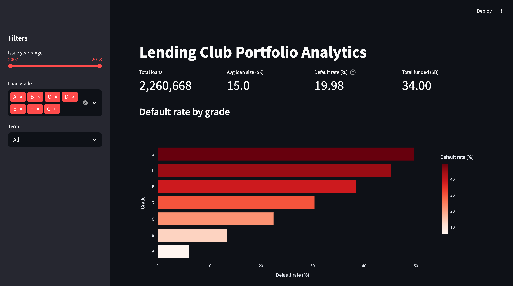

# Financial Data Warehouse Pipeline

End-to-end **Lending Club** loan data pipeline: raw CSV → star-schema DuckDB warehouse → SQL analytics and an interactive Streamlit dashboard.



**Stack:** Python 3.11 · pandas · DuckDB · Streamlit · Plotly · scikit-learn · LightGBM · SHAP · pytest · uv · ruff

**Dataset:** [Kaggle — Lending Club Loan Data](https://www.kaggle.com/datasets/wordsforthewise/lending-club) (~2.26M loans, 2007–2018). Place `accepted_2007_to_2018Q4.csv` at `data/raw/lending_club_loans.csv`.

**Repo:** [github.com/dhwanil1907/financial-data-warehouse-pipeline](https://github.com/dhwanil1907/financial-data-warehouse-pipeline)

**Docs:** [docs/concepts.md](docs/concepts.md) · [docs/architecture.md](docs/architecture.md)
---

## Features

- Schema validation and data-quality checks that fail the run: required columns, null keys, repeated loan IDs
- Star schema (1 fact + 4 dimensions) with surrogate keys, loaded in one transaction with row-count verification, so a failed run leaves the previous warehouse intact
- 13 analytical SQL queries using CTEs and window functions
- Streamlit dashboard with 4 Plotly charts
- Default-prediction notebook: logistic regression vs LightGBM on a time-based split, plus an approval-cutoff vs profit analysis
- pytest suite (39 passing) and reproducible setup via uv

## Warehouse tables

| Table | Rows |
|---|---|
| `fact_loans` | 2,260,668 |
| `dim_borrower` | 90,211 |
| `dim_loan_grade` | 35 |
| `dim_purpose` | 28 |
| `dim_time` | 139 |

## Key metrics

| Metric | Value |
|---|---|
| Loans analyzed | 2,260,668 |
| Resolved loans (Fully Paid or defaulted) | 1,348,099 |
| Overall default rate (resolved loans) | 19.98% |
| Loan amount range | $500 – $40,000 |
| Average loan amount | ≈ $15,047 |

**Default definition:** `is_default` is TRUE for Charged Off, Default and the "Does not meet the credit policy" Charged Off status, FALSE for Fully Paid, and NULL for loans still in progress (Current, Late, In Grace Period). Rates are averaged over resolved loans only, so in-progress loans don't dilute them.

Default rate by loan grade (`sql/analytics/01_default_rate_by_grade.sql`):

| Grade | A | B | C | D | E | F | G |
|---|---|---|---|---|---|---|---|
| Default rate | 6.04% | 13.40% | 22.44% | 30.38% | 38.43% | 45.15% | 49.67% |

Default risk rises monotonically from grade A to G — roughly 8× higher for G than A.

## Default model

[`notebooks/default_model.ipynb`](notebooks/default_model.ipynb) predicts default from application-time features (loan amount, interest rate, term, grade, DTI, income, employment length, purpose, state). Payment columns such as `total_pymnt` and `recoveries` are excluded because they are only known after the loan runs.

- **Data:** resolved loans only, pulled from the warehouse with SQL.
- **Split:** train on loans issued 2007–2015 (829,355 loans), test on 2016–2017 (462,426 loans). No hyperparameter tuning, so there is no validation set.
- **Results** (also in `notebooks/metrics.json`):

| Model | AUC | KS | Brier |
|---|---|---|---|
| Interest rate only | 0.687 | 0.272 | n/a |
| Logistic regression | 0.694 | 0.282 | 0.166 |
| LightGBM | 0.700 | 0.288 | 0.166 |

The gain over the interest rate alone is small, because Lending Club already prices risk into grade and rate. Grade, interest rate and term drive most of the LightGBM score (SHAP). Both models under-predict default on the test years (23.2% observed vs 18.5% in training), partly because 2017 loans only appear once resolved, which skews them toward early defaults. Ranking metrics are less affected than calibration.

## Findings: approval cutoff vs profit

The same notebook asks which loans a lender should approve. Profit per loan is `total_pymnt − funded_amnt`, so it includes interest and recoveries but ignores funding cost, servicing and the time value of money. It is measured on **36-month loans issued in 2015** (283,026 loans, all past their full term by the end of the data), scored by a LightGBM trained only on earlier loans (AUC 0.682 on this cohort). Recent loans can't be used: resolved 2016–2017 loans return −4.3% overall, because loans only appear in the data once they resolve.

1. **Higher risk is mostly paid for in the interest rate.** Default rates run from 5.4% (A) to 46.1% (G), yet the return on money lent is 6.9% (A), 7.4% (B), 6.5% (C), 4.9% (D), 2.2% (E), −1.8% (F) and −5.3% (G).
2. **Approving everyone earns the most.** Total profit is $237.4M (a 6.55% return). The riskiest fifth of applicants, with a 27.4% default rate, still earns $26.3M (3.9%).
3. **A tighter cutoff raises return per dollar but gives up profit.** Approving only the safest 60% returns 7.4% but earns $169.4M, $68.1M less than approving all.
4. **In 2015, only grades F and G lose money**, about $0.4M across 1,606 loans, and grade E is barely positive. That result is specific to 2015 (see the next section).
5. **The model beats ranking by interest rate when approvals are limited.** At 60% approved it earns $169.4M vs $161.3M, and at 20% $63.4M vs $55.6M. The two converge when everyone is approved.

### Does it hold for other years?

The same analysis on 36-month loans issued in 2013 and 2014, each scored by a model trained only on earlier loans:

| Issued | Loans | Default rate | Approve-all return | Safest 60%: model vs rate ranking | Grades F+G return |
|---|---|---|---|---|---|
| 2013 | 100,422 | 12.33% | 11.05% | $94.0M vs $83.8M | +10.47% |
| 2014 | 162,570 | 13.73% | 9.00% | $124.2M vs $113.2M | +9.22% |
| 2015 | 283,026 | 14.89% | 6.55% | $169.4M vs $161.3M | −2.31% |

Two findings hold in all three years: approving everyone earns the most total profit, and the model beats ranking by interest rate at a 60% cutoff. The grade F/G result does not. Those grades were profitable in 2013 and 2014 and lost money only in 2015, as returns fell each year. So rejecting F and G is a call about one vintage's pricing, not a rule for every year. The 2013 model has the least history to learn from (loans issued through 2012).

---

## Quick start

```bash
uv sync
```

### 1. Load the DuckDB warehouse

```bash
uv run python -m src.pipeline --csv data/raw/lending_club_loans.csv --db warehouse.duckdb
```

Expected output:
```
dim_borrower:  90,211
dim_loan_grade:    35
dim_purpose:       28
dim_time:         139
fact_loans: 2,260,668
```

### 2. Launch the dashboard

```bash
uv run streamlit run dashboard/app.py
```

Open **http://localhost:8501**. Uses `warehouse.duckdb` by default — override with `DUCKDB_PATH=/path/to/db`.

**DuckDB lock:** do not run the ETL pipeline and the dashboard against the same `.duckdb` file at the same time. Finish (or stop) the pipeline before opening Streamlit, or you will get a conflicting-lock `IOException`.

### 3. Run tests

```bash
uv run pytest tests/ -v
```

39 tests pass.

### 4. SQL analytics (ad-hoc)

```bash
duckdb warehouse.duckdb < sql/analytics/01_default_rate_by_grade.sql
```

All 13 queries are in `sql/analytics/`.

### 5. Default model notebook (optional)

Needs the warehouse from step 1. The modeling packages live in their own dependency group:

```bash
uv run --group modeling jupyter nbconvert --execute --to notebook --inplace notebooks/default_model.ipynb
```

---

## Architecture

```
data/raw/lending_club_loans.csv
          │
          ▼
┌──────────────┐
│  extract.py  │  validate schema
└──────┬───────┘
       │
       ▼
┌──────────────┐
│ transform.py │  drop footer rows, build dim + fact DataFrames, surrogates
└──────┬───────┘
       │
       ▼
┌──────────┐
│  load.py │  one transaction, row counts verified
│ → DuckDB │
└────┬─────┘
     │
     ▼
warehouse.duckdb
     │
  ┌──┴──────────────────┐
  ▼                     ▼
sql/analytics/     dashboard/app.py
(13 SQL files)     (Streamlit + Plotly)
```

See [docs/architecture.md](docs/architecture.md) for the full data-flow write-up.

---

## Project layout

```
├── src/
│   ├── pipeline.py          # ETL orchestrator (CLI: --csv, --db)
│   ├── extract.py           # CSV load + schema validation
│   ├── transform.py         # dim/fact builders, data quality helpers
│   ├── load.py              # DuckDB INSERT OR IGNORE helpers
│   └── db.py                # DuckDB connection + DDL runner
├── sql/
│   ├── schema/
│   │   └── create_tables.sql  # Star schema DDL (5 tables)
│   └── analytics/             # 13 analytical queries (CTEs + window fns), see its README
├── dashboard/
│   └── app.py               # Streamlit dashboard (4 Plotly charts)
├── docs/
│   ├── architecture.md      # Data-flow write-up
│   ├── dashboard.png        # Screenshot used at the top of this README
│   └── concepts.md          # Concepts used in this project
├── notebooks/
│   ├── default_model.ipynb  # logistic regression vs LightGBM, plus cutoff vs profit
│   └── metrics.json         # saved model metrics
├── tests/                   # pytest suite (39 passing)
├── data/
│   └── raw/                  # lending_club_loans.csv (gitignored)
├── pyproject.toml           # dependencies and Python version
├── uv.lock                  # locked dependency versions
├── .python-version          # Python 3.11 for uv
└── .gitignore / .gitattributes
```
